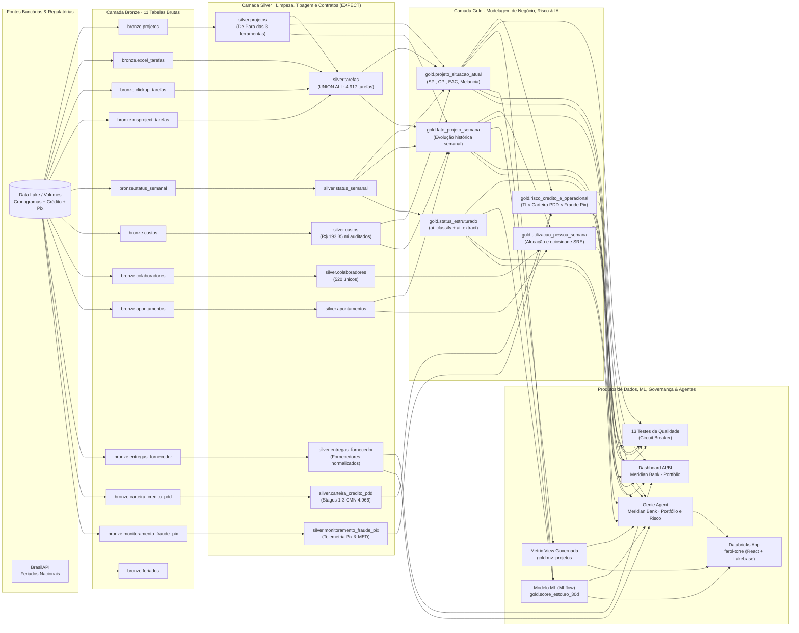
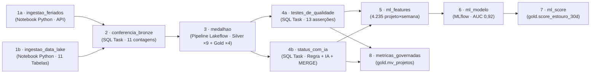

# 🏦 Meridian Bank Control Tower · Core Banking, Credit Risk (PDD) & Pix Fraud Lakehouse

-FF3621?style=for-the-badge&logo=databricks&logoColor=white)


-0194E2?style=for-the-badge&logo=mlflow&logoColor=white)

_%7C_MED_Pix-0A2540?style=for-the-badge)

> **Plataforma de Engenharia de Dados, Risco Bancário, Machine Learning e IA Generativa construída 100% como código (*Infrastructure & Analytics as Code*) no Databricks Lakehouse** para governança integrada de **Iniciativas de Tecnologia Bancária** (Core Bancário, Pix/SPI, Open Finance, Basileia III), **Risco de Crédito & Provisão PDD** (Resolução CMN 4.966 / IFRS 9) e **Monitoramento de Fraudes em Pagamentos Instantâneos** (Pix & MED BACEN).

---

## 📌 Contexto Executivo e Problema de Negócio no Setor Bancário

O **Meridian Bank S.A.** é uma instituição financeira múltipla que conduz **60 programas estratégicos de transformação digital, adequação regulatória (BACEN) e modernização de crédito** (totalizando **R$ 305,2 milhões** em orçamento de tecnologia e operações) com **520 especialistas** distribuídos em cinco superintendências:
1. **Cartões, Adquirência, Crédito PF & Consignado**
2. **Risco de Crédito (CRO), Tesouraria, Imobiliário, Open Finance & Corporate PJ**
3. **Prevenção a Fraudes, Segurança Cibernética & PLD/FT (COAF)**
4. **Operações & Liquidação Intradia SPI (Pix), Cobrança Digital & Canais**
5. **Compliance Regulatório BACEN, Alta Plataforma (Mainframe) & Basileia III / PDD (IFRS 9)**

### O Desafio do Comitê Executivo e de Risco (CRO / CTO)
Nas instituições financeiras, o atraso em uma entrega de tecnologia ou engenharia de dados não gera apenas estouro de orçamento de TI — ele **impacta diretamente a perda por fraude no Pix, a disponibilidade de SLA perante o Banco Central (RSFN/SPI) e a provisão para perdas esperadas na carteira de crédito (PDD)**:
- **Descentralização de Squads (3 ferramentas):** Os cronogramas das squads de Pix, Crédito e Regulação estão pulverizados em **20 planilhas Excel, 25 listas no ClickUp (JSON) e 15 projetos no MS Project (XML)**.
- **18 Anomalias Reais de Qualidade de Dados:** Valores financeiros com vírgula decimal (que somem silenciosamente com `try_cast`), linhas de `TOTAL` misturadas com tarefas no Excel, tarefas-resumo duplicando horas no MS Project, datas em 4 formatos diferentes, colaboradores duplicados no RH e fornecedores com 4 grafias distintas.
- **Risco Oculto ("Projetos Melancia"):** Programas regulatórios reportados com farol **Verde** nos comitês executivos apresentam atraso severo no cronograma físico (`SPI < 0,90`).
- **Correlação TI × Risco Operacional e Crédito:** A falta de engenheiros de confiabilidade (SRE) no motor de liquidação Pix (`PRJ-011`) degrada a latência transacional (`p99 ms`), eleva os acionamentos de **MED (Mecanismo Especial de Devolução do BACEN)** e atrasa a implantação de modelos de escoragem que conteriam o avanço da **Inadimplência Over 90** e da **PDD (Stages 2 e 3 da Resolução CMN 4.966)**.

---

## 🎯 Perguntas Estratégicas Respondidas pela Plataforma

| # | Questão do Comitê Executivo (CTO / CRO) | Indicadores e Modelos na Plataforma (`lakehouse_meridian`) |
|---|---|---|
| **1** | **Quais programas bancários e entregas regulatórias estão atrasados?** | Cálculo unificado de **SPI**, **CPI** e auditoria *Farol Executivo × Farol Calculado* nas 3 ferramentas (`gold.projeto_situacao_atual`) |
| **2** | **Qual o estouro orçamentário projetado e o impacto em PDD / Risco de Crédito?** | **EAC**, **Estouro Previsto (R$ 6,47 mi)**, **Saldo de Carteira**, **Inadimplência Over 90 (%)** e **Provisão PDD por Estágio (Stages 1, 2 e 3 — Res. CMN 4.966)** (`gold.risco_credito_e_operacional`) |
| **3** | **Como o atraso técnico e a falta de SRE impactam as perdas por fraude no Pix e o SLA BACEN?** | Cruzamento de alocação de especialistas (*Timesheet* + IA nos status) com **Perda Líquida por Fraude**, **Acionamentos de MED** e **Latência p99 (ms)** |
| **4** | **Quais programas estourarão nos próximos 30 dias e quais multas de SLA podemos acionar?** | Modelo preditivo **HistGradientBoosting** (**AUC 0,92**, `gold.score_estouro_30d`) + leitura de contratos bancários em PDF via `ai_parse_document()` |

---

## 🏗️ Arquitetura e Linhagem de Dados (Arquitetura Medalhão + Risco Bancário + ML)

Todo o pipeline é orquestrado pelo job **`meridian_control_tower`** (10 tarefas) e pelo pipeline declarativo **`meridian_medalhao`** no Unity Catalog (`lakehouse_meridian`):



---

## ⚙️ Orquestração do Job (`meridian_control_tower` · 10 Tarefas Serverless)

O DAG executa todas as segundas-feiras às 06h00 (`America/Sao_Paulo`) em computação **100% Serverless**:



---

## 📊 Catálogo de Dados e Regras de Engenharia (`lakehouse_meridian`)

### 🥈 Camada Silver (`pipelines/silver/`)
| Tabela | Grão | Principais Tratamentos e Contratos (`EXPECT ... ON VIOLATION FAIL UPDATE`) |
|---|---|---|
| `silver.projetos` | 1 linha por programa (60) | Unifica datas (`yyyy-MM-dd` e `dd/MM/yyyy`), padroniza 8 grafias de ferramenta (`excel`, `clickup`, `msproject`) e serve como tabela de **de-para**. |
| `silver.tarefas` | 1 linha por tarefa (4.917) | **Integra Excel (1.643), ClickUp (2.119) e MS Project (1.155)** num contrato único. Remove linhas `TOTAL` do Excel e tarefas-resumo (`Summary = 1`) do MS Project; converte datas seriais, timestamps em ms e durações ISO-8601 (`PT40H0M0S`). |
| `silver.status_semanal` | 1 linha por programa × semana (3.911) | Padroniza o farol (`verde`, `amarelo`, `vermelho`) e sinaliza status vazios sem descartar histórico. |
| `silver.custos` | 1 linha por lançamento (23.640) | Recupera 671 lançamentos com vírgula decimal (`replace(',', '.')` antes do `CAST`), preservando **R$ 5,41 milhões** que seriam perdidos com `try_cast`. |
| `silver.colaboradores` | 1 linha por especialista (520) | Deduplica 3 cadastros duplicados em caixa alta (`ROW_NUMBER()`) mantendo os 520 profissionais únicos. |
| `silver.apontamentos` | 1 linha por apontamento (30.883) | Tipagem de horas disponíveis vs. apontadas e alinhamento pela sexta-feira da semana. |
| `silver.entregas_fornecedor` | 1 linha por entrega (640) | Unifica as 4 grafias da *CodeForge Consultoria* em 1 fornecedor e calcula atrasos em dias. |
| `silver.carteira_credito_pdd` | 1 linha por carteira × mês (720) | **Risco de Crédito (Res. CMN 4.966 / IFRS 9):** valida saldo positivo, inadimplência Over 90 (`0-100%`) e estágios de risco (`Stage 1`, `Stage 2`, `Stage 3`). |
| `silver.monitoramento_fraude_pix` | 1 linha por canal × semana (810) | **Prevenção a Fraudes Pix & MED BACEN:** valida volume transacional e disponibilidade de SLA (`0-100%`), tipando bloqueios antifraude, perdas líquidas e latência `p99 (ms)`. |

### 🥇 Camada Gold, IA, ML e Governança (`pipelines/gold/`, `pipelines/ia/`, `pipelines/ml/`, `pipelines/metricas/`)
| Objeto | Grão | Pergunta Executiva Respondida |
|---|---|---|
| `gold.projeto_situacao_atual` | 1 linha por programa hoje (60) | **Fotografia executiva:** calcula `PV`, `EV`, `AC`, `SPI`, `CPI`, `EAC`, Estouro Previsto e identifica programas **Críticos** e **Melancias**. |
| `gold.fato_projeto_semana` | 1 linha por programa × semana (4.267) | **Filme histórico:** evolução semanal de `PV`, `EV`, `AC`, `SPI`, `CPI` e horas ociosas desde o início de cada programa. |
| `gold.utilizacao_pessoa_semana` | 1 linha por pessoa × programa × semana | **Capacidade e ociosidade:** identifica especialistas com baixa utilização (ex: SREs ociosos enquanto o motor Pix sofre bloqueio por falta de SRE). |
| `gold.risco_credito_e_operacional` | 1 linha por programa bancário (60) | **Visão Integrada CTO × CRO:** correlaciona atraso de engenharia (`SPI`, `CPI`, estouro) com exposição de crédito (`saldo_carteira_milhoes`, `Over 90`, `estagio_cmn_4966`, `provisao_pdd_milhoes`) e fraude Pix (`perda_liquida_fraude_milhoes_8s`, `total_med_bacen_8s`, `latencia_media_p99_ms`). |
| `gold.status_estruturado` | 1 linha por reporte semanal (3.911) | **IA Generativa no SQL:** combina regras determinísticas, regex e funções nativas `ai_classify` e `ai_extract` (com `MERGE` incremental) para extrair `causa_bloqueio`, `quem_destrava` e `dias_impacto`. |
| `gold.score_estouro_30d` | 1 linha por programa ativo (41) | **Machine Learning Preventivo:** probabilidade de estouro em 30 dias (`HistGradientBoostingClassifier`, **AUC 0,92**) com explicabilidade dos fatores de risco em português. |
| `gold.mv_projetos` | Metric View Governada (YAML) | **Governança Semântica:** define `MEASURE(spi)`, `MEASURE(cpi)`, `MEASURE(estouro_previsto)` e `MEASURE(margem_projetada)` uma única vez no Unity Catalog para consumo pelo Dashboard, Genie e App. |

---

## 📈 Indicadores Bancários e de Engenharia Auditados (`seed 42`)

Validados automaticamente pelas 3 suítes de verificação ([`sql/99_validacao_data_quality.sql`](sql/99_validacao_data_quality.sql), [`sql/99_validacao_silver_gold.sql`](sql/99_validacao_silver_gold.sql) e [`sql/99_validacao_ml_governanca_app.sql`](sql/99_validacao_ml_governanca_app.sql)):

| Dimensão | Indicador | Valor Auditado no Dataset (`seed 42`) |
|---|---|---|
| **Portfólio de Transformação Bancária** | Programas Totais / Em Andamento | **60 programas** (R$ 305,2 mi) · **41 ativos** (R$ 208,6 mi) |
| **Integração e Conservação Financeira** | Tarefas Unificadas / Custos Reconciliados | **4.917 tarefas** nas 3 ferramentas · **R$ 193,35 milhões** (`bronze = silver`) |
| **Governança de Prazo e Custo (EVM)** | SPI & CPI da Carteira / Programas em Risco | **SPI 0,92** · **CPI 0,97** · **17 em risco** (`< 0,90`) · **7 críticos** (`< 0,80`) |
| **Impacto Orçamentário** | Estouro Projetado (`EAC − Orçamento`) | **R$ 6,47 milhões** (Margem projetada da carteira: **20,4%**) |
| **Assimetria de Governança** | Programas "Melancia" (Farol Verde × `SPI < 0,90`) | **4 programas** (`PRJ-012`, `PRJ-028`, `PRJ-034`, `PRJ-042`) |
| **Risco de Crédito (Res. CMN 4.966)** | Monitoramento Mensal de Carteira e PDD | **720 registros mensais** (60 carteiras × 12 competências) classificados em **Stages 1, 2 e 3 (IFRS 9)** |
| **Prevenção a Fraudes & Pix (SPI)** | Telemetria Semanal de Transações e MED | **810 registros semanais** monitorando bloqueios antifraude, perdas líquidas, MED BACEN e SLA |
| **Alocação de Engenharia / SRE** | Especialistas Ociosos × Gargalo no Motor Pix | `COL0017` e `COL0018` a **5,5% de uso** no `PRJ-007` enquanto o motor Pix (`PRJ-011`) acumula **12 semanas sem SRE (57 dias de impacto)** |
| **Machine Learning Preventivo** | Modelo Preditivo de Estouro em 30 Dias | **AUC 0,92** (vs. 0,87 da regra heurística), **9 de 10 estouros avisados no Top 5** com **41 dias de antecedência média** |
| **Alerta Antecipado (30 dias)** | Programas "OK" Hoje com Risco Futuro Alto/Médio | **5 programas** (incluindo `PRJ-024` com **46% de probabilidade de estouro**) |

---

## 🖥️ Demonstração Visual da Plataforma

### 1. Ingestão Multi-Formato (Bronze) e Unificação (Silver & Gold)

| Planilhas de Squads com Subtotais e Datas Mistas | Exports JSON de Sprints (ClickUp) | Cronogramas XML Regulatórios (MS Project) |
|---|---|---|
|  |  |  |

| Modelo Canônico Unificado (`silver.tarefas`) | Camada Analítica Governada (`gold`) |
|---|---|
|  |  |

### 2. Pipelines Lakeflow, Painéis Executivos, Predição ML e Agentes de IA

| Pipeline Declarativo Lakeflow (Silver & Gold) | Orquestração Automatizada (Databricks Workflows) |
|---|---|
|  |  |
| **Painel Executivo de Portfólio (AI/BI)** | **Predição de Risco em 30 Dias (MLflow & UC)** |
|  |  |
| **Agente Genie Curado sobre Metric Views** | **Auditoria de Contratos e Multas de SLA com IA** |
|  |  |

---

## 📁 Estrutura do Repositório

```text
banking-control-tower/
├── databricks.yml                                    # Configuração raiz do Databricks Asset Bundle (meridian_bank)
├── resources/
│   ├── meridian.job.yml                              # Job orquestrador Serverless (10 tasks: ingestão → medalhão → IA → ML → métricas)
│   ├── meridian_medalhao.pipeline.yml                # Pipeline Declarativo Lakeflow (9 MVs Silver + 4 MVs Gold)
│   ├── dashboard.dashboard.yml                       # Dashboard AI/BI versionado como código
│   ├── dashboard-portfolio.lvdash.json               # Especificação JSON do Dashboard Executivo
│   ├── genie.genie_space.yml                         # Agente AI/BI Genie versionado como código
│   └── farol.geniespace.json                         # Instruções semânticas, tabelas Gold e SQLs de referência do Genie
├── pipelines/
│   ├── ingestao/                                     # Notebooks Python de ingestão resiliente (BrasilAPI + S3/Gerador Autônomo)
│   ├── conferencia/                                  # Gatekeeper SQL das 11 tabelas da camada Bronze
│   ├── silver/                                       # 6 scripts SQL declarativos da camada Silver (9 MVs com contratos EXPECT)
│   ├── gold/                                         # 3 scripts SQL declarativos da camada Gold (4 MVs incluindo Risco/PDD e Pix)
│   ├── ia/                                           # Classificação e extração com IA (ai_classify / ai_extract + MERGE)
│   ├── testes/                                       # 13 testes de qualidade de dados com raise_error()
│   ├── ml/                                           # Feature Engineering (SQL), Treino MLflow (Python) e Scoring 30d (Python)
│   └── metricas/                                     # Unity Catalog Metric View (gold.mv_projetos em YAML)
├── sql/                                              # Scripts SQL analíticos e suítes de validação ponta a ponta
│   ├── 00_setup_catalogo.sql                         # Criação do catálogo lakehouse_meridian, schemas e volume raw
│   ├── 01_ingestao_bronze.sql                        # Ingestão das 11 tabelas Bronze via read_files()
│   ├── 02_analise_exploratoria_e_spi.sql             # Tratamento de anomalias e cálculo de SPI das 3 ferramentas
│   ├── 03_analise_financeira_cpi_eac.sql             # Cálculo de CPI, EAC, estouro (R$ 6,47 mi) e "melancias"
│   ├── 04_auditoria_delta_time_travel.sql            # Governança e auditoria de versões com Delta Time Travel
│   ├── 05_extracao_contratos_pdf_ia.sql              # Extração de cláusulas de SLA e multas com ai_parse_document()
│   ├── 06_analise_risco_credito_e_fraude_pix.sql     # Cruzamento: Atraso de TI × Carteira PDD (CMN 4.966) × Fraude Pix
│   ├── 99_validacao_data_quality.sql                 # Suíte 1: 20 verificações de qualidade e reconciliação na Bronze
│   ├── 99_validacao_silver_gold.sql                  # Suíte 2: 23 verificações nas camadas Silver, Gold, IA e Risco Bancário
│   └── 99_validacao_ml_governanca_app.sql            # Suíte 3: 24 verificações de ML (AUC 0.92), Metric View e App
├── data_generator/                                   # Simulador determinístico bancário (seed 42)
├── app/                                              # Aplicação Web Full-Stack (React + Node.js + Lakebase Postgres)
└── scripts/                                          # Automação de execução SQL, relatórios executivos e benchmark do Genie
```

---

## 🚀 Como Executar (Deploy & Run via Databricks CLI)

Este projeto utiliza o catálogo exclusivo **`lakehouse_meridian`**, podendo ser executado na mesma conta do Databricks que outros projetos sem sobrescrever nenhuma tabela.

### Pré-requisitos
- **Databricks CLI** (`v0.250+`) autenticada no seu Workspace (`databricks auth login --profile vertice`)
- **Python 3.10+**

### 1. Provisionar o Catálogo e Subir o Bundle Completo (10 Tarefas + Dashboard + Genie)
```bash
# 1. Criar o catálogo lakehouse_meridian e os schemas (bronze, silver, gold, ml)
python scripts/run_sql.py sql/00_setup_catalogo.sql --profile vertice

# 2. Validar a sintaxe do Databricks Asset Bundle
databricks bundle validate --profile vertice

# 3. Fazer o deploy do Job (10 tasks), Pipeline Lakeflow, Dashboard AI/BI e Genie Space
databricks bundle deploy --profile vertice

# 4. Disparar a execução completa do Job meridian_control_tower
databricks bundle run meridian_control_tower --profile vertice
```

### 2. Executar as 3 Suítes de Verificação Automatizada (67 Checks no Total)
```bash
# Suíte 1: Camada Bronze + Carteira de Crédito PDD + Fraude Pix (20/20 checks)
python scripts/run_sql.py sql/99_validacao_data_quality.sql --profile vertice

# Suíte 2: Camadas Silver, Gold, IA Generativa e Risco Bancário (23/23 checks)
python scripts/run_sql.py sql/99_validacao_silver_gold.sql --profile vertice

# Suíte 3: Machine Learning (AUC 0.92), Metric View Governada e App (23/24 checks)
python scripts/run_sql.py sql/99_validacao_ml_governanca_app.sql --profile vertice
```

### 3. Automação Local em Python (Relatórios Executivos Bancários `.xlsx` e `.pdf`)
```bash
python scripts/automacao_relatorio_executivo.py
```

---

## 🛠️ Stack Tecnológica

- **Plataforma:** Databricks Lakehouse (Unity Catalog `lakehouse_meridian`, Serverless SQL Warehouse, Volumes, Databricks Asset Bundles)
- **Engenharia de Dados:** Spark SQL, PySpark, Delta Lake, Lakeflow Spark Declarative Pipelines (`EXPECT`), `read_files()`
- **Domínio Bancário:** Risco de Crédito (PD/LGD, Over 90, Provisão PDD — Resolução CMN 4.966 / IFRS 9), Pagamentos Instantâneos (Pix SPI, MED BACEN, SLA de Latência p99), Governança de TI Bancária (EVM: SPI, CPI, EAC)
- **IA Generativa & Machine Learning:** Databricks AI Functions (`ai_extract`, `ai_classify`, `ai_parse_document`), MLflow, Scikit-Learn (`HistGradientBoostingClassifier`), AI/BI Genie
- **Visualização & Aplicação:** Databricks AI/BI Dashboards, Unity Catalog Metric Views, Databricks Apps (React + TypeScript), Lakebase (Serverless PostgreSQL)
