# 🏦 Meridian Bank Control Tower · Core Banking, Credit Risk (PDD) & Pix Fraud Lakehouse

[](https://www.databricks.com/)
[-0A2540)](https://www.bcb.gov.br/)
[](https://www.databricks.com/product/unity-catalog)
[](https://delta.io/)
[](https://mlflow.org/)
[](https://www.python.org/)
[](LICENSE)

> **Plataforma de Engenharia de Dados, Risco Bancário e IA Generativa construída no Databricks** para governança integrada de **Iniciativas de Tecnologia Bancária** (Core Bancário, Pix/SPI, Open Finance, Basileia III), **Risco de Crédito & Provisão PDD** (Resolução CMN 4.966 / IFRS 9) e **Monitoramento de Fraudes em Pagamentos Instantâneos** (Pix & MED BACEN).

---

## 📌 Contexto Executivo e Problema de Negócio no Setor Bancário

O **Meridian Bank S.A.** é uma instituição financeira múltipla que conduz **60 programas estratégicos de transformação digital, adequação regulatória (BACEN) e modernização de crédito** (totalizando **R$ 305,2 milhões** em orçamento de tecnologia e operações) com **520 especialistas** distribuídos em cinco superintendências:
1. **Cartões, Adquirência, Crédito PF & Consignado**
2. **Risco de Crédito (CRO), Tesouraria, Imobiliário, Open Finance & Corporate PJ**
3. **Prevenção a Fraudes, Segurança Cibernética & PLD/FT (COAF)**
4. **Operações & Liquidação Intradia SPI (Pix), Cobrança Digital & Canais**
5. **Compliance Regulatório BACEN, Alta Plataforma (Mainframe) & Basileia III / PDD (IFRS 9)**

### O Desafio do Comitê Executivo e de Risco (CRO / CTO)
Nas instituições financeiras, o atraso em uma entrega de tecnologia ou engenharia de dados não gera apenas estouro de orçamento de TI — ele **impacta diretamente a perda por fraude no Pix, a disponibilidade de SLA perante o Banco Central (RSFN/SPI) e a provisão para perdas esperadas na carteira de crédito (PDD)**:
* **Descentralização de Squads:** Os cronogramas das squads de Pix, Crédito e Regulação estão pulverizados em **20 planilhas Excel, 25 listas no ClickUp (JSON) e 15 projetos no MS Project (XML)**.
* **Risco Oculto ("Projetos Melancia"):** Programas regulatórios reportados com farol **Verde** nos comitês executivos apresentam atraso severo no cronograma físico (`SPI < 0,90`).
* **Correlação TI × Risco Operacional e Crédito:** A falta de engenheiros de confiabilidade (SRE) no motor de liquidação Pix (`PRJ-011`) degrada a latência transacional (`p99 ms`), eleva os acionamentos de **MED (Mecanismo Especial de Devolução do BACEN)** e atrasa a implantação de modelos de escoragem que conteriam o avanço da **Inadimplência Over 90** e da **PDD (Stages 2 e 3 da Resolução CMN 4.966)**.

---

## 🎯 Perguntas Estratégicas Respondidas pela Plataforma

| # | Questão do Comitê Executivo (CTO / CRO) | Indicadores e Modelos na Plataforma (`lakehouse_meridian`) |
|---|---|---|
| **1** | **Quais programas bancários e entregas regulatórias estão atrasados?** | Cálculo unificado de **SPI**, **CPI** e auditoria *Farol Executivo × Farol Calculado* nas 3 ferramentas |
| **2** | **Qual o estouro orçamentário projetado e o impacto em PDD / Risco de Crédito?** | **EAC**, **Estouro Previsto (R$ 6,47 mi)**, **Saldo de Carteira**, **Inadimplência Over 90 (%)** e **Provisão PDD por Estágio (Stages 1, 2 e 3 — Res. CMN 4.966)** |
| **3** | **Como o atraso técnico e a falta de SRE impactam as perdas por fraude no Pix e o SLA BACEN?** | Cruzamento de alocação de especialistas (*Timesheet* + IA nos status) com **Perda Líquida por Fraude**, **Acionamentos de MED** e **Latência p99 (ms)** |
| **4** | **Quais programas estourarão nos próximos 30 dias e quais multas de SLA podemos acionar?** | Modelo preditivo **HistGradientBoosting** (**AUC 0,92**) + leitura de contratos bancários em PDF via `ai_parse_document()` |

---

## 🏛️ Arquitetura Lakehouse Bancária (Databricks)

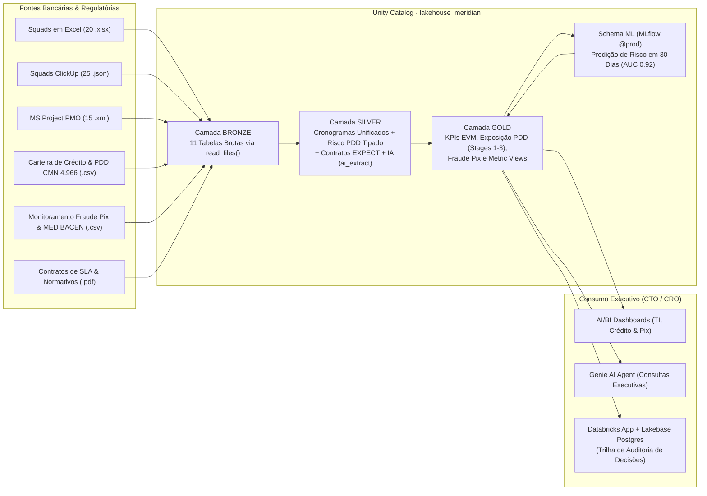

---

## 📊 Indicadores Bancários e de Engenharia Auditados

| Dimensão | Indicador | Valor Auditado no Dataset (`seed 42`) |
|---|---|---|
| **Portfólio de Transformação Bancária** | Programas Totais / Em Andamento | **60 programas** (R$ 305,2 mi) · **41 ativos** (R$ 208,6 mi) |
| **Governança de Prazo e Custo (EVM)** | Programas em Risco / Críticos | **17 em risco** (`SPI` ou `CPI < 0,90`) · **7 críticos** (`< 0,80`) |
| **Impacto Orçamentário** | Estouro Projetado (`EAC − Orçamento`) | **R$ 6,47 milhões** concentrados em projetos com expansão de escopo regulatório |
| **Assimetria de Governança** | Programas "Melancia" (Farol Verde × `SPI < 0,90`) | **4 programas** (`PRJ-012`, `PRJ-028`, `PRJ-034`, `PRJ-042`) |
| **Risco de Crédito (Res. CMN 4.966)** | Monitoramento Mensal de Carteira e PDD | **720 registros mensais** (60 carteiras × 12 competências) classificados em **Stages 1, 2 e 3 (IFRS 9)** |
| **Prevenção a Fraudes & Pix (SPI)** | Telemetria Semanal de Transações e MED | **810 registros semanais** monitorando bloqueios antifraude, perdas líquidas, MED BACEN e SLA |
| **Alocação de Engenharia / SRE** | Especialistas Ociosos × Gargalo no Motor Pix | **2 SREs seniores a ~5%** no `PRJ-007` enquanto o motor Pix (`PRJ-011`) acumula 12 semanas sem SRE |
| **Machine Learning Preventivo** | Modelo Preditivo de Estouro em 30 Dias | **AUC 0,92** (antecedência média de **41 dias** antes da quebra do indicador) |
| **Conformidade de Fornecedores** | Multas Contratuais de SLA Apuradas via IA | **R$ 1,12 milhão** sobre atrasos recorrentes (+41% de prazo) em sprints terceirizadas |

---

## 🖥️ Demonstração Visual da Plataforma

### 1. Ingestão Multi-Formato (Bronze) e Unificação (Silver & Gold)

| Planilhas de Squads com Subtotais e Datas Mistas | Exports JSON de Sprints (ClickUp) | Cronogramas XML Regulatórios (MS Project) |
|---|---|---|
| 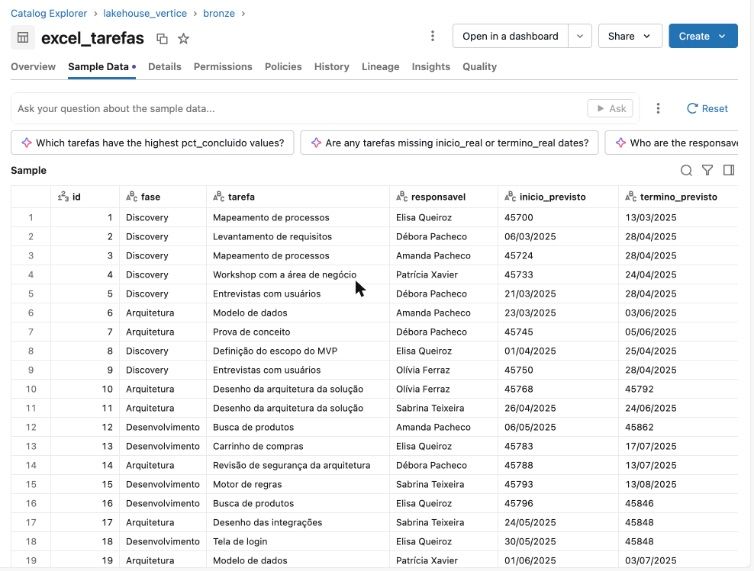 | 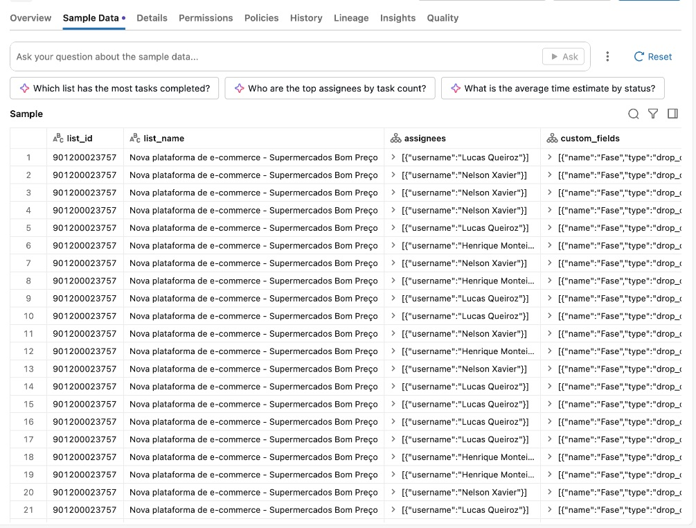 | 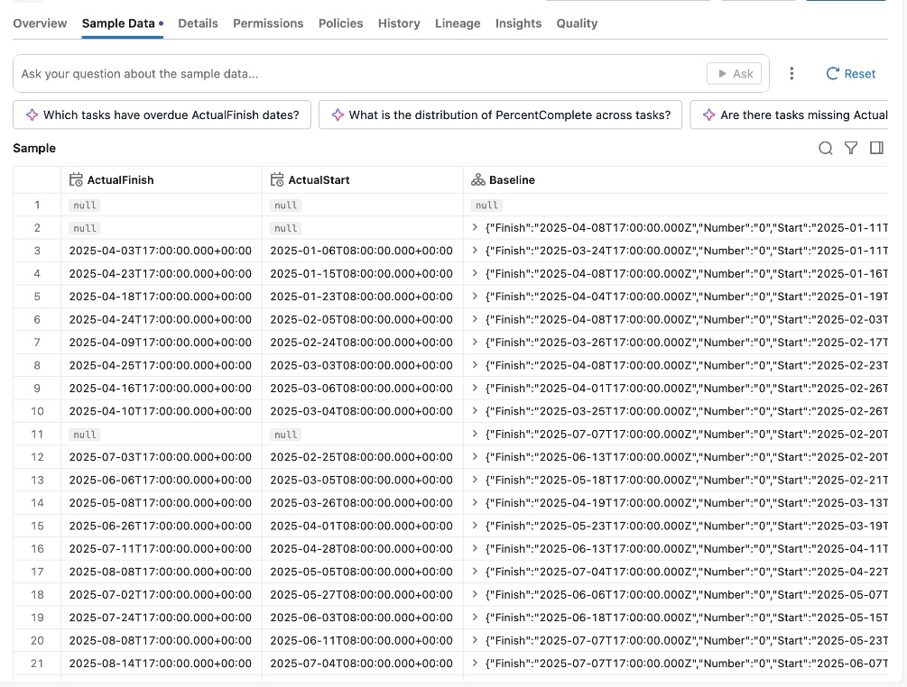 |

| Modelo Canônico Unificado (`silver.tarefas`) | Camada Analítica Governada (`gold`) |
|---|---|
| 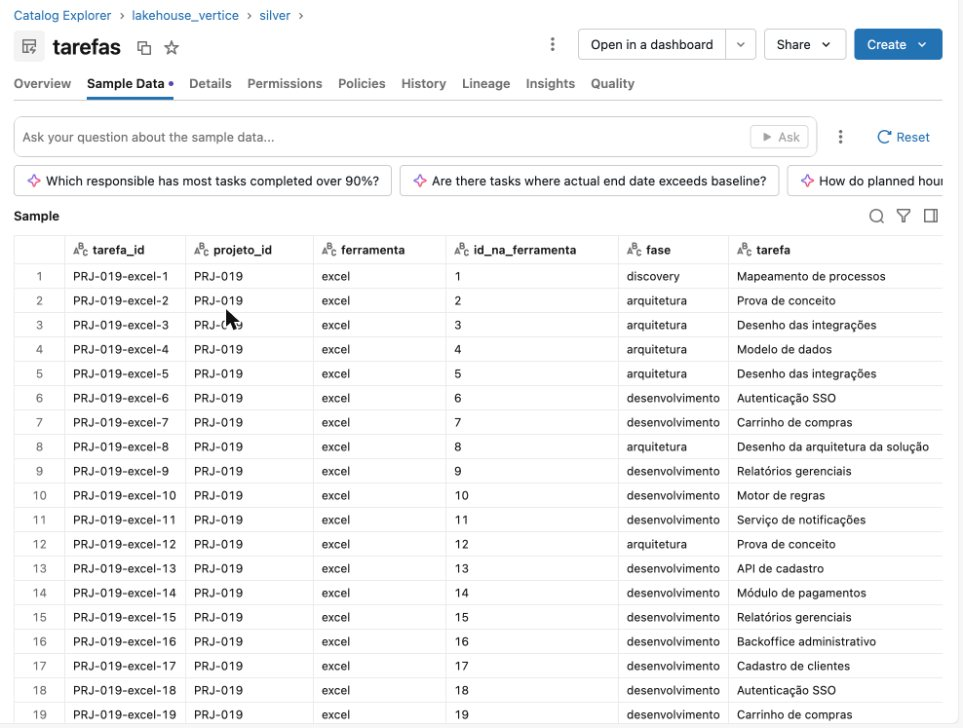 | 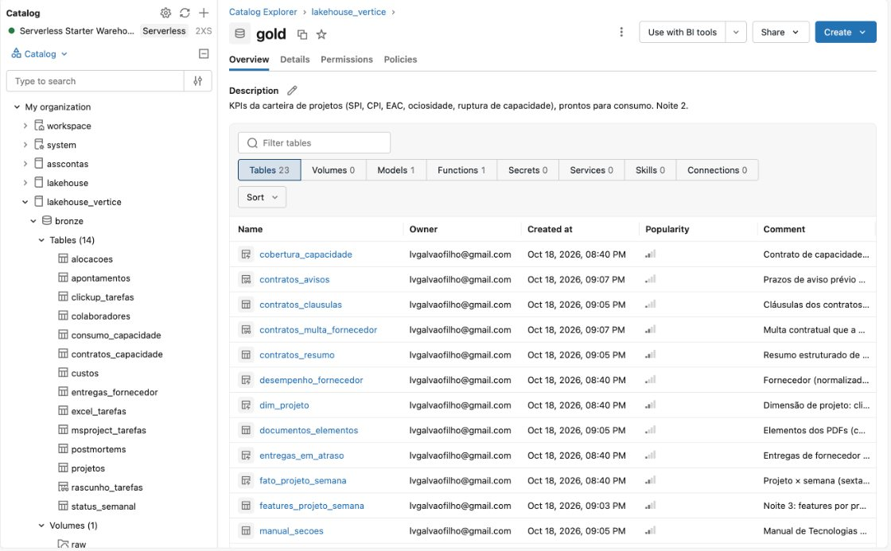 |

### 2. Pipelines Lakeflow, Painéis Executivos, Predição ML e Agentes de IA

| Pipeline Declarativo Lakeflow (Silver & Gold) | Orquestração Automatizada (Databricks Workflows) |
|---|---|
| 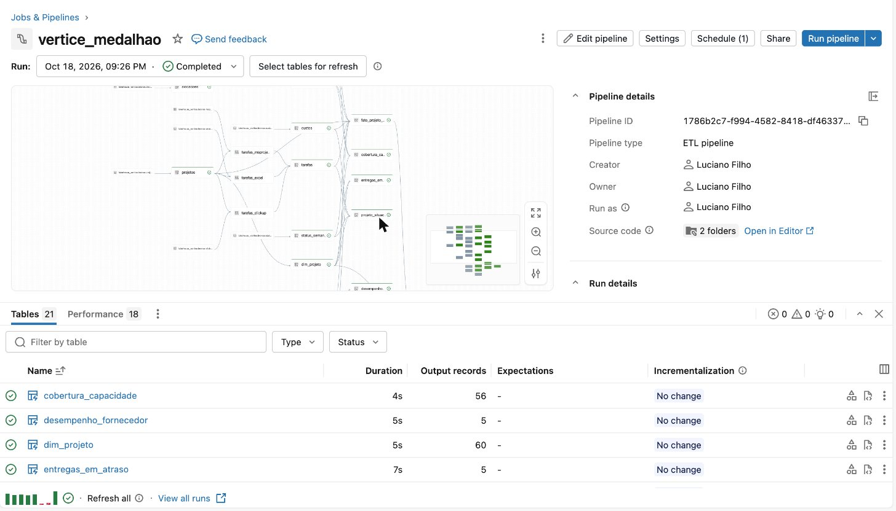 | 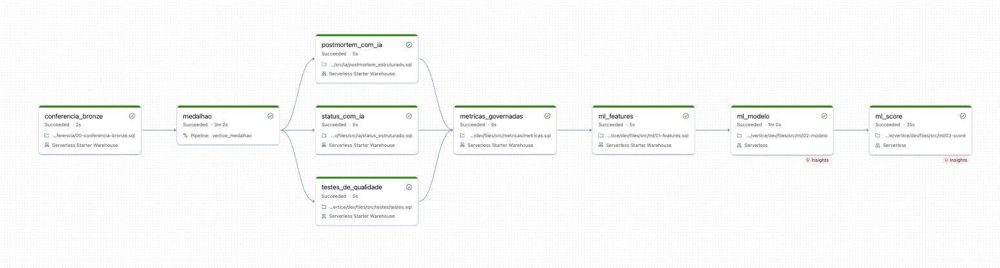 |
| **Painel Executivo de Portfólio (AI/BI)** | **Predição de Risco em 30 Dias (MLflow & UC)** |
| 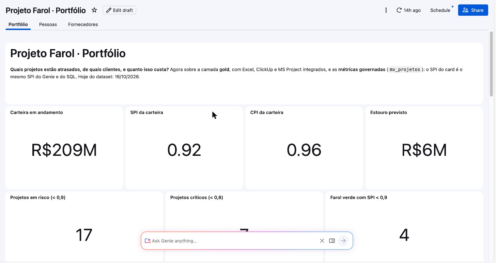 | 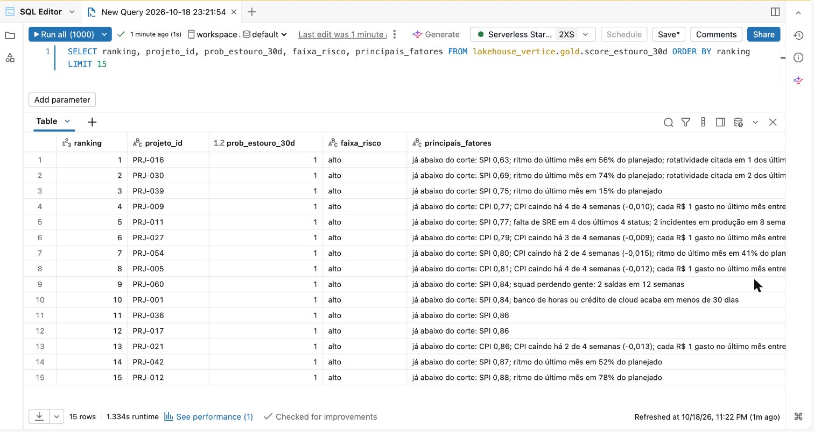 |
| **Agente Genie Curado sobre Metric Views** | **Auditoria de Contratos e Multas de SLA com IA** |
| 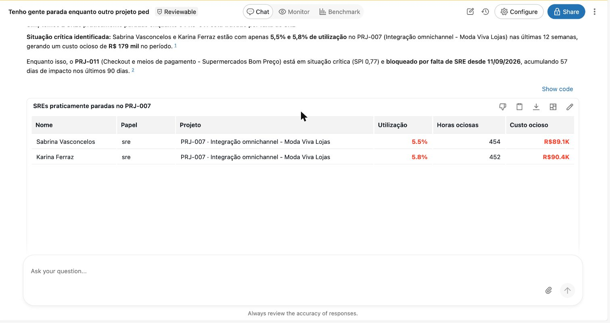 | 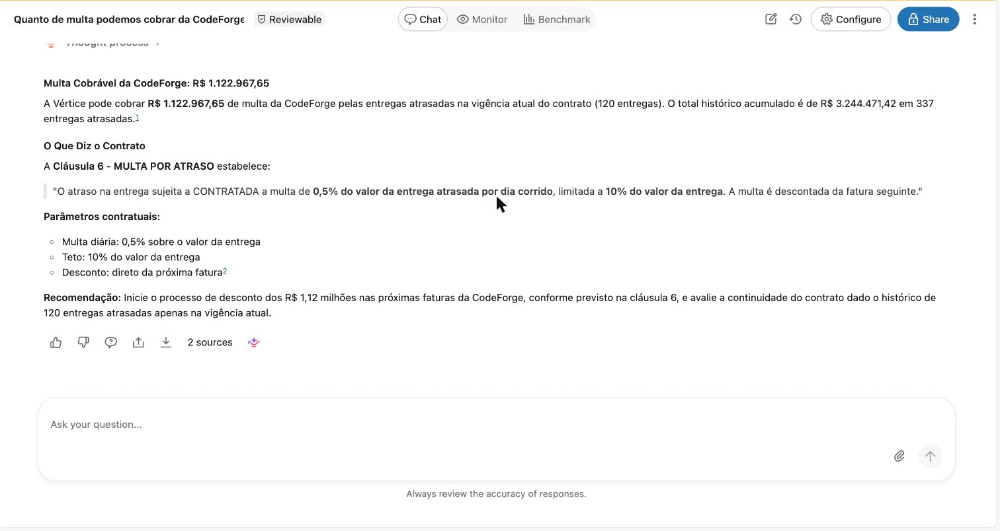 |

---

## 📁 Estrutura do Repositório

```text
banking-control-tower/
├── databricks.yml                                    # Configuração do Databricks Asset Bundle (bundle: meridian_bank)
├── data_generator/                                   # Simulador determinístico bancário (seed 42)
│   ├── gerar_dataset.py                              # Gera cronogramas de TI + Carteira de Crédito/PDD + Fraude Pix
│   ├── validar_padroes.py                            # Valida integridade matemática e regras de negócio bancárias
│   ├── xlsx_simples.py                               # Escritor/leitor nativo de planilhas .xlsx
│   └── pdf_simples.py                                # Escritor nativo de contratos bancários e normativos em .pdf
├── sql/                                              # Scripts SQL para execução no Databricks SQL Editor
│   ├── 00_carregar_dados.py                          # Notebook que provisiona lakehouse_meridian e gera os arquivos
│   ├── 00_setup_catalogo.sql                         # Criação do catálogo lakehouse_meridian, schemas e volume raw
│   ├── 01_ingestao_bronze.sql                        # Ingestão das 11 tabelas Bronze via read_files()
│   ├── 02_analise_exploratoria_e_spi.sql             # Tratamento de anomalias e cálculo de SPI das 3 ferramentas
│   ├── 03_analise_financeira_cpi_eac.sql             # Cálculo de CPI, EAC, estouro (R$ 6,47 mi) e "melancias"
│   ├── 04_auditoria_delta_time_travel.sql            # Governança e auditoria de versões com Delta Time Travel
│   ├── 05_extracao_contratos_pdf_ia.sql              # Extração de cláusulas de SLA e multas com ai_parse_document()
│   ├── 06_analise_risco_credito_e_fraude_pix.sql     # Cruzamento: Atraso de TI × Carteira PDD (CMN 4.966) × Fraude Pix
│   └── 99_validacao_data_quality.sql                 # Reconciliação automatizada de 20 checks de qualidade de dados
├── pipelines/                                        # Pipeline Medalhão Declarativo (Silver/Gold), IA e MLflow
├── dashboards_and_genie/                             # Datasets SQL e especificações JSON de Dashboards e Genie
├── resources/                                        # Definições de Jobs, Pipelines, Dashboards e Genie do Bundle
├── app/                                              # Aplicação Web Full-Stack (React + Node.js + Lakebase Postgres)
└── scripts/                                          # Automação de execução SQL e deploy de agentes
```

---

## 🚀 Como Executar no Databricks (Sem Conflito com Outros Projetos)

Este projeto utiliza o catálogo exclusivo **`lakehouse_meridian`**, podendo ser executado na mesma conta do Databricks que outros projetos sem sobrescrever nenhuma tabela.

### 1. Provisionar o Catálogo `lakehouse_meridian` e Gerar os Dados Bancários
1. Importe este repositório no Databricks Workspace (**Workspace → Create → Git folder**).
2. Abra o notebook [`sql/00_carregar_dados.py`](sql/00_carregar_dados.py), confirme que o parâmetro `catalogo` no topo está como `lakehouse_meridian` e clique em **Run all**.

### 2. Ingerir as 11 Tabelas Bronze e Executar as Análises Bancárias
1. No **SQL Editor**, execute [`sql/01_ingestao_bronze.sql`](sql/01_ingestao_bronze.sql) para criar as **11 tabelas Delta** em `lakehouse_meridian.bronze` (incluindo `carteira_credito_pdd` e `monitoramento_fraude_pix`).
2. Execute [`sql/02_analise_exploratoria_e_spi.sql`](sql/02_analise_exploratoria_e_spi.sql) e [`sql/03_analise_financeira_cpi_eac.sql`](sql/03_analise_financeira_cpi_eac.sql) para criar a view unificada de cronogramas e auditar o portfólio.
3. Execute [`sql/06_analise_risco_credito_e_fraude_pix.sql`](sql/06_analise_risco_credito_e_fraude_pix.sql) para analisar a **Provisão PDD por Estágio (Resolução CMN 4.966)**, a **Inadimplência Over 90** e a correlação entre atrasos de engenharia (`SPI`) e **Perdas por Fraude no Pix / Acionamentos de MED BACEN**.
4. Execute [`sql/99_validacao_data_quality.sql`](sql/99_validacao_data_quality.sql) para verificar que todos os **20 testes de qualidade** retornam `ok`.

### 3. Automação Local em Python (Relatórios Executivos Bancários `.xlsx` e `.pdf`)
Para rodar localmente o pipeline de automação em Python que consolida os cronogramas das 3 ferramentas com a **Carteira de Crédito / PDD (Resolução CMN 4.966)** e o **Monitoramento de Fraude Pix (MED BACEN)**, gerando automaticamente a planilha executiva e o relatório em PDF para o Comitê de Risco (`CRO`) e Tecnologia (`CTO`) em `relatorios_automatizados/`:

```bash
python scripts/automacao_relatorio_executivo.py
```

---

## 🛠️ Stack Tecnológica

* **Plataforma:** Databricks Lakehouse (Unity Catalog `lakehouse_meridian`, Serverless SQL Warehouse, Volumes)
* **Engenharia de Dados:** Spark SQL, PySpark, Delta Lake, Lakeflow Declarative Pipelines (`EXPECT`), `read_files()`
* **Domínio Bancário:** Risco de Crédito (PD/LGD, Over 90, Provisão PDD — Resolução CMN 4.966 / IFRS 9), Pagamentos Instantâneos (Pix SPI, MED BACEN, SLA de Latência p99), Governança de TI Bancária (EVM: SPI, CPI, EAC)
* **IA Generativa & Machine Learning:** Databricks AI Functions (`ai_extract`, `ai_classify`, `ai_parse_document`), MLflow, Scikit-Learn (`HistGradientBoostingClassifier`), AI/BI Genie
* **Visualização & Aplicação:** Databricks AI/BI Dashboards, Metric Views, Databricks Apps (React + TypeScript), Lakebase (Serverless PostgreSQL)
